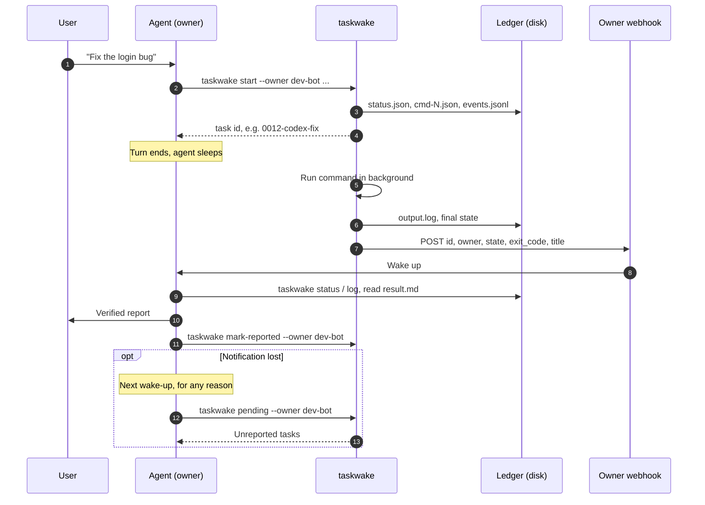
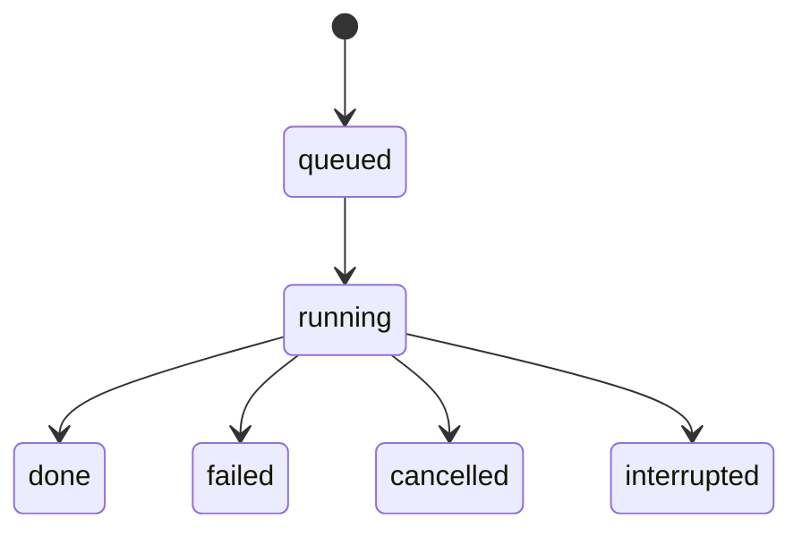

<div align="center">

# ⏰ taskwake

**AI エージェント向けのバックグラウンドタスク台帳。タスクが終わると、そのタスクを発行したエージェントを Webhook で起こします。**

[](https://github.com/sdpwh7-ux/taskwake/actions/workflows/ci.yml)
[](LICENSE)
[](https://www.python.org/)
[](#-特長)
[](#-特長)

[English](README.md) | [简体中文](README.zh-CN.md) | **日本語**

</div>

> 40 分かかる `codex exec` をバックグラウンドに回してターンを終えても、完了したらエージェントが起こされます。ポーリングは不要で、結果を忘れることもありません。

---

## 🤔 なぜ必要か

チャット型のエージェント（ターン単位で動くボット）は、長いジョブが苦手です。40 分かかる `codex exec` や調査スクリプトをバックグラウンドに回すと、ターンが終わってエージェントは眠ってしまいます。**ジョブが終わっても誰も教えてくれない**ので、ポーリングし続けて利用枠を消費するか、ジョブのことを忘れてしまいます。

taskwake は、3 つのシンプルな仕組みでこれを解決します。

1. **台帳（Ledger）。** すべてのタスクに `0012-codex-fix` のような ID が付きます。状態、コマンド、stdout/stderr、イベントはディスクに書き込まれ、ディスク上の記録が唯一の正となります。
2. **起床（Wake-up）。** タスクが終わると、taskwake は*そのタスクを発行したエージェント自身の* Webhook に小さな JSON を POST します。Webhook には、エージェントを起動できる HTTP エンドポイントなら何でも使えます（スケジューラ、ボットプラットフォームの Webhook トリガー、CI の `repository_dispatch` 中継など）。起きたエージェントは結果を確認してユーザーに報告し、タスクを報告済みにします。
3. **取りこぼし対策（Catch-up）。** 通知は失われることがあります。そこでエージェントは、どんな理由で起きたときでも `taskwake pending --owner <me>` を実行し、まだ報告していないタスクを報告します。

## ✨ 特長

- 📒 **ディスク上の台帳**：タスクごとに状態・コマンド・出力・イベントログを残します。ID は見ればわかる形式です。
- 🔔 **発行元だけを起こす**：Webhook はタスクを発行したエージェントにだけ送られます。
- 🔁 **取りこぼし対策を内蔵**：`pending` で完了済み・未報告のタスクを一覧できるので、通知が失われても結果は失われません。
- 🧩 **どんなコマンドもラップ可能**：Codex CLI、Claude Code（`claude -p`）、調査スクリプト、バッチジョブ、普通のシェルに対応します。
- ♻️ **再開可能**：同じコマンドで再実行することも、新しいコマンドで続けることもできます。Codex の `session id` は `codex_session` として記録されます。
- ⏱️ **プロセス監視**：タイムアウトに対応し、キャンセルはプロセスグループ単位で行います（SIGTERM、10 秒後に SIGKILL）。実行プロセスが消えた場合は `interrupted` として検出します。
- 👥 **マルチエージェント対応**：オーナー単位で分離するので、同じマシン上のエージェント同士が互いの成果を報告したり、握りつぶしたりしません。
- 🔐 **認証情報の扱いに配慮**：Webhook のキーは一切表示せず、設定ファイルは mode 600 で作成し、Webhook 関連の変数は子プロセスの環境から取り除きます。
- 🪶 **依存ゼロ**：標準ライブラリだけで書かれた Python（3.9+）の単一ファイルです。POSIX 専用（`fcntl` とプロセスグループを使用）。Linux で動作確認済みで、macOS でも動くはずです。

## ⚙️ 仕組み



タスクのライフサイクル：



`interrupted` は、再起動後などに実行プロセスが消えたことを表します。taskwake は次のコマンド実行時にこれを自動で検出します。

## 🚀 クイックスタート

### インストール

```bash
git clone https://github.com/sdpwh7-ux/taskwake.git
ln -s "$PWD/taskwake/taskwake" ~/.local/bin/taskwake    # or call taskwake.py directly
taskwake --help
```

### タスクの発行と管理

```bash
# dispatch (backgrounds immediately and prints the task id)
taskwake start --owner research-bot --name demo --title "Smoke test" --sh 'sleep 5; echo hello'

taskwake list --owner research-bot         # running and recent tasks
taskwake status 0001-demo                  # details + recent events
taskwake log 0001-demo -n 50               # tail of output
taskwake cancel 0001-demo                  # SIGTERM the process group, SIGKILL after 10 s
taskwake resume 0001-demo                  # run again in the same task (same command)
taskwake resume 0001-demo --sh 'new cmd'   # continue with a new command
taskwake pending --owner research-bot      # finished but not yet reported
taskwake mark-reported 0001-demo --owner research-bot   # alias: ack
taskwake notify 0001-demo                  # resend the wake-up once
```

その他のオプション：`--cwd DIR`、`--timeout SEC`（デフォルトは無制限）、`--stdin FILE|-`、`--fg`（フォアグラウンドで実行し、コマンドの終了コードを返す）。

コマンドの中では次の変数が使えます。

| 変数 | 意味 |
| --- | --- |
| `$TASKWAKE_ID` | タスク ID |
| `$TASKWAKE_DIR` | タスクディレクトリ（例：結論を `$TASKWAKE_DIR/result.md` に書き出す） |
| `$TASKWAKE_RUN` | 現在の実行 |
| `$TASKWAKE_OWNER` | タスクのオーナー |

終了コード：

| コード | 意味 |
| --- | --- |
| `0` | 完了 |
| `1` | 失敗 / 拒否 |
| `2` | 使い方の誤り |
| `124` | タイムアウト |
| `130` | キャンセル |

### 使用例

**Codex CLI**。最終回答を保存しておき、後で確認できるようにします。taskwake は出力から Codex の `session id` を読み取り、`status.json` に `codex_session` として記録するので、そのセッションを再開できます。

```bash
taskwake start --owner dev-bot --name codex-fix --cwd ~/src/myrepo --title "Fix login bug" \
  --sh 'codex exec --skip-git-repo-check -o "$TASKWAKE_DIR/result.md" "Fix the login bug, run the tests, list changed files"'

S=$(python3 -c 'import json,sys;print(json.load(open(sys.argv[1]))["codex_session"])' ~/.local/state/taskwake/tasks/0012-codex-fix/status.json)
taskwake resume 0012-codex-fix --sh "codex exec resume -o \"\$TASKWAKE_DIR/result.md\" $S 'One test still fails, keep going'"
```

**Claude Code**。プロンプトを stdin で渡します。

```bash
taskwake start --owner dev-bot --name claude-refactor --stdin prompt.txt -- claude -p
```

### オーナー

すべてのタスクに発行元（`--owner` または `$TASKWAKE_OWNER`）が記録され、オーナーを指定しないと開始できません。起床通知はそのオーナーの Webhook にだけ送られます。`pending` と `list` はオーナーで絞り込みます。`mark-reported` には `--owner` が必須で、他のオーナーのタスクは受け付けません。これにより、1 台のマシンを共有する複数のエージェントが、互いの成果を報告したり握りつぶしたりすることを防ぎます。

`TASKWAKE_CHILD_OWNER_VAR=MY_AGENT_NAME` を設定すると、オーナーをその変数名でも子プロセスに渡します。エージェントごとに利用量を集計したいときに便利です。

### Webhook の設定

URL とキーは、オーナーごとに一度保存するだけです。キーが表示されることはありません。

```bash
taskwake webhook-set --owner research-bot                                   # interactive, hidden input
taskwake webhook-set --owner research-bot --url https://... --key-file /path/to/keyfile
printf '%s' "$KEY" | taskwake webhook-set --owner research-bot --url https://... --key-stdin
taskwake webhook-check --owner research-bot   # "configured / not configured" + key length only
taskwake webhook-test  --owner research-bot   # sends {"source":"taskwake","event":"test"}
```

設定は `~/.config/taskwake/<owner>.env` に mode 600 で書き込まれます（`examples/owner.env.example` を参照）。環境変数 `TASKWAKE_WEBHOOK_URL` / `TASKWAKE_WEBHOOK_KEY` が設定されている場合は、そちらが優先されます。

Webhook がなくても taskwake は動きます。タスクはそのまま記録され、イベントログには `notify skipped` と残ります。エージェントは次に起きたときに `pending` で取りこぼしを拾います。

### 送信される内容

```
POST <your webhook URL>
Content-Type: application/json
Authorization: Bearer <key>

{"source":"taskwake","id":"0012-codex-fix","owner":"dev-bot","state":"done","exit_code":0,"title":"Fix login bug"}
```

送るのはタスクのメタデータ（ID、オーナー、状態、終了コード、タイトル）だけで、コマンドラインやその出力は一切送りません。2xx が返れば成功です。失敗した場合は 0、5、20、60、180 秒後に再試行します（`TASKWAKE_RETRY_DELAYS`）。400/401/403/404 は設定ミスとみなし、再試行しません。受信側が別のヘッダーでもキーを必要とする場合は、`TASKWAKE_WEBHOOK_KEY_HEADER=X-Your-Header` を設定してください。`TASKWAKE_NOTIFY_OFF=1` で起床通知を無効にできます。

### エージェント向けの指示

`examples/agent-skill.md` は、発行元エージェント向けのプロンプトで、用途に合わせて手直しして使えます。下流に渡すプロンプトの書き方、タスクを発行してターンを終える方法、起こされたときの確認と報告の方法、ack するタイミングをまとめています。

## 🔧 設定

| 変数 | デフォルト | 意味 |
| --- | --- | --- |
| `TASKWAKE_DIR` | `$XDG_STATE_HOME/taskwake/tasks` または `~/.local/state/taskwake/tasks` | 台帳ディレクトリ |
| `TASKWAKE_CONF_DIR` | `~/.config/taskwake` | オーナーごとの Webhook 設定 |
| `TASKWAKE_OWNER` | - | デフォルトのオーナー |
| `TASKWAKE_WEBHOOK_URL` / `TASKWAKE_WEBHOOK_KEY` | - | オーナーごとの設定を上書き |
| `TASKWAKE_WEBHOOK_KEY_HEADER` | - | キーを追加で載せるヘッダー |
| `TASKWAKE_RETRY_DELAYS` | `0,5,20,60,180` | 各通知試行の前に待つ秒数 |
| `TASKWAKE_NOTIFY_OFF` | - | `1` で通知を無効化 |
| `TASKWAKE_CHILD_OWNER_VAR` | - | オーナーをこの変数名でも子プロセスに渡す |

各タスクの台帳ディレクトリには `status.json`、`events.jsonl`、`output.log`、`cmd-N.json`、`input-N.txt`（任意）、`result.md`（任意、コマンドが書き出すもの）が入ります。

## 🛡️ セキュリティモデル

> エージェントに taskwake を渡す前に、必ず読んでください。

- **シェルアクセス。** taskwake は、渡されたコマンドを呼び出したユーザーの全権限でそのまま実行します。台帳でありプロセス監視ツールであって、**サンドボックスではありません**。サンドボックス化はコマンド自体で行ってください（コンテナ、`codex --sandbox`、権限を絞ったユーザーなど）。
- **認証情報。** Webhook の URL とキーを読むのは taskwake だけです。`TASKWAKE_WEBHOOK_URL` と `TASKWAKE_WEBHOOK_KEY` は子プロセスの環境から取り除かれ、`webhook-set`/`webhook-check` がキーを表示することはなく、設定ファイルは mode 700 のディレクトリに mode 600 で作成されます。ただし、環境変数にある他のシークレットは子プロセスに*引き継がれます*。必要なら自分で取り除いてください。
- **ネットワーク。** taskwake が外部に送るのは、設定した Webhook への POST だけです。中身はタスクのメタデータ（ID、オーナー、状態、終了コード、タイトル）のみなので、タイトルにシークレットを入れないでください。
- **ファイル。** 台帳にはコマンドライン全体、stdin、出力がそのまま入ります。`TASKWAKE_DIR` は他人から読めないようにしてください（パーミッションは umask に従います）。また、コマンドラインにシークレットを書かないでください。
- **プロンプトインジェクション。** Webhook の本文は信頼できないヒントとして扱い、エージェントには台帳を読み直させてください。エージェントが `output.log` のコマンド出力を読み返すときも、同じく信頼できない入力として扱ってください。
- **オーナーの分離は運用上の約束で、隔離ではありません。** 同じ Unix ユーザーで動くプロセスなら、どのタスクでも読み書きできます。本当に隔離したい場合は、別々のユーザーを使ってください。

## 🗺️ プロジェクトの状況とロードマップ

taskwake は**オープンソース化したばかり**です。ここに記載したコマンド・オプション・変数が、現時点でできることのすべてです。粗い部分が残っている可能性があり、フィードバックに応じてインターフェースが変わることもあります。

**既知の制限**

- 再起動すると実行中のタスクは終了し、`interrupted` と表示されます。実行プロセス自体が `kill -9` された場合、その子プロセスは動き続けることがあります。
- 1 つのタスクで同時に実行できるのは 1 回だけです。実行中は `resume` が拒否されます。

**特にフィードバックを歓迎すること**

- 上記の既知の制限への対処方法。
- macOS での利用報告（動くはずですが、まだテストしていません）。
- 起床 Webhook をさまざまなエージェント基盤やスケジューラにつなぐ方法。

決まったスケジュールはありません。優先順位は Issue と実際の利用状況で決めます。

## 🤝 コントリビュート

Issue やプルリクエストを歓迎します。

- **単一ファイル・標準ライブラリのみ・依存ゼロ**という設計は維持してください。
- プルリクエストでは CI ワークフローが通ることを確認してください。
- 動作を変える場合は README も更新してください（できれば翻訳版も）。
- セキュリティに関わる問題は、公開の Issue ではなく GitHub 経由でメンテナーに非公開で連絡してください。

## 📄 ライセンスとクレジット

Robbin Fan による [robbin/grokbot-local-agent](https://github.com/robbin/grokbot-local-agent) のタスク台帳の設計（MIT）をもとにしています。上流のライセンスは `LICENSE.upstream-MIT` に残してあります。

本プロジェクトは [MIT License](LICENSE) で公開しています。

---

### 🧰 エージェントツールキット（Part of the agent toolkit）

| リポジトリ | |
| --- | --- |
| [**taskwake**](https://github.com/sdpwh7-ux/taskwake) | ← このリポジトリ |
| [agent-search-kit](https://github.com/sdpwh7-ux/agent-search-kit) | |
| [streamsafe](https://github.com/sdpwh7-ux/streamsafe) | |
| [agent-usage-ledger](https://github.com/sdpwh7-ux/agent-usage-ledger) | |
| [git-box-sync](https://github.com/sdpwh7-ux/git-box-sync) | |
