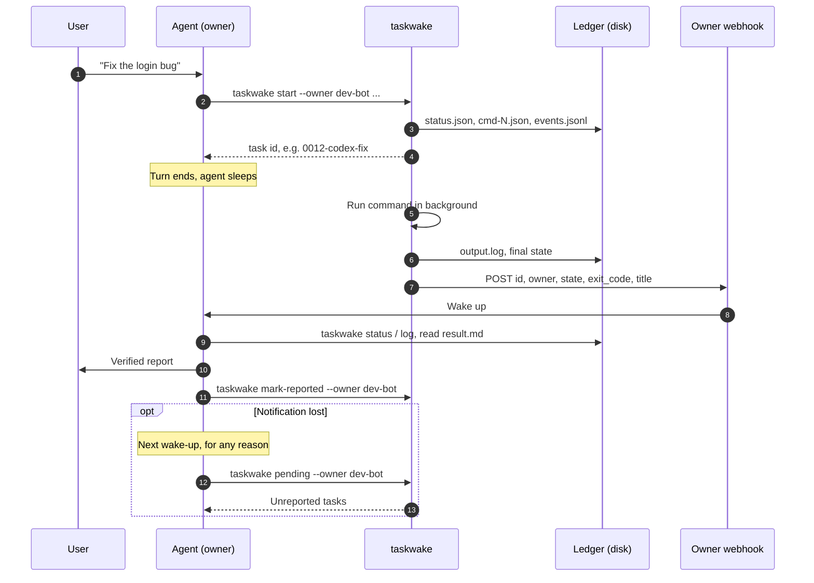
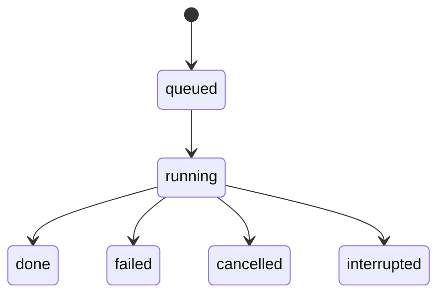

<div align="center">

# ⏰ taskwake

**A background-task ledger for AI agents, plus a webhook that wakes the agent that dispatched the task when it finishes.**

[](https://github.com/sdpwh7-ux/taskwake/actions/workflows/ci.yml)
[](LICENSE)
[](https://www.python.org/)
[](#features)
[](#features)

**English** | [简体中文](README.zh-CN.md) | [日本語](README.ja.md)

</div>

> Send a 40-minute `codex exec` to the background, end the turn, and get woken up when it's done. No polling, and the result doesn't get forgotten.

---

## 🤔 Why

Chat-style agents (bots that run in turns) have a problem with long jobs. Once they send a 40-minute `codex exec` or a research script to the background, the turn ends and the agent goes to sleep. **Nobody tells it when the job is done**, so it either polls (and burns quota) or forgets about the job.

taskwake fixes this with three small ideas:

1. **Ledger.** Every task gets an id like `0012-codex-fix`. Its state, command, stdout/stderr and events are written to disk. The disk is the source of truth.
2. **Wake-up.** When the task ends, taskwake POSTs a tiny JSON payload to *the dispatching agent's own* webhook. That can be any HTTP endpoint that triggers your agent: a scheduler, a bot platform's webhook trigger, a CI `repository_dispatch` relay, and so on. The agent wakes up, checks the result, reports to the user, and marks the task as reported.
3. **Catch-up.** Notifications can get lost. Whenever the agent wakes up for any reason, it runs `taskwake pending --owner <me>` and reports anything it hasn't reported yet.

## ✨ Features

- 📒 **Disk-backed ledger.** State, command, output and an event log for every task, with ids you can read.
- 🔔 **Owner-targeted wake-ups.** Only the agent that dispatched a task gets its webhook call.
- 🔁 **Catch-up built in.** `pending` lists tasks that finished but haven't been reported, so a lost notification doesn't lose a result.
- 🧩 **Wraps any command.** Works with Codex CLI, Claude Code (`claude -p`), research scripts, batch jobs and plain shell.
- ♻️ **Resumable.** Re-run a task, or continue it with a new command. The Codex `session id` is recorded as `codex_session`.
- ⏱️ **Process supervision.** Timeouts and process-group cancellation (SIGTERM, then SIGKILL after 10 s). Runs that disappear are detected as `interrupted`.
- 👥 **Multi-agent friendly.** Owner separation stops agents that share a machine from reporting, or swallowing, each other's work.
- 🔐 **Careful with credentials.** Webhook keys are never printed, config files are mode 600, and webhook variables are removed from the child environment.
- 🪶 **Zero dependencies.** A single file of standard-library Python (3.9+). POSIX only: it uses `fcntl` and process groups. Tested on Linux; it should work on macOS.

## ⚙️ How it works



Task lifecycle:



`interrupted` means the runner process disappeared, for example after a reboot. taskwake detects this automatically on the next command.

## 🚀 Quick start

### Install

```bash
git clone https://github.com/sdpwh7-ux/taskwake.git
ln -s "$PWD/taskwake/taskwake" ~/.local/bin/taskwake    # or call taskwake.py directly
taskwake --help
```

### Dispatch and manage tasks

```bash
# dispatch (backgrounds immediately and prints the task id)
taskwake start --owner research-bot --name demo --title "Smoke test" --sh 'sleep 5; echo hello'

taskwake list --owner research-bot         # running and recent tasks
taskwake status 0001-demo                  # details + recent events
taskwake log 0001-demo -n 50               # tail of output
taskwake cancel 0001-demo                  # SIGTERM the process group, SIGKILL after 10 s
taskwake resume 0001-demo                  # run again in the same task (same command)
taskwake resume 0001-demo --sh 'new cmd'   # continue with a new command
taskwake pending --owner research-bot      # finished but not yet reported
taskwake mark-reported 0001-demo --owner research-bot   # alias: ack
taskwake notify 0001-demo                  # resend the wake-up once
```

Other options: `--cwd DIR`, `--timeout SEC` (default: none), `--stdin FILE|-`, `--fg` (run in the foreground and return the command's exit code).

Variables available inside the command:

| Variable | Meaning |
| --- | --- |
| `$TASKWAKE_ID` | task id |
| `$TASKWAKE_DIR` | the task directory (for example, write your conclusion to `$TASKWAKE_DIR/result.md`) |
| `$TASKWAKE_RUN` | current run |
| `$TASKWAKE_OWNER` | owner of the task |

Exit codes:

| Code | Meaning |
| --- | --- |
| `0` | done |
| `1` | failed / refused |
| `2` | usage error |
| `124` | timeout |
| `130` | cancelled |

### Examples

**Codex CLI**, with the final answer saved so it can be checked. taskwake records the Codex `session id` from the output as `codex_session` in `status.json`, so you can resume the session:

```bash
taskwake start --owner dev-bot --name codex-fix --cwd ~/src/myrepo --title "Fix login bug" \
  --sh 'codex exec --skip-git-repo-check -o "$TASKWAKE_DIR/result.md" "Fix the login bug, run the tests, list changed files"'

S=$(python3 -c 'import json,sys;print(json.load(open(sys.argv[1]))["codex_session"])' ~/.local/state/taskwake/tasks/0012-codex-fix/status.json)
taskwake resume 0012-codex-fix --sh "codex exec resume -o \"\$TASKWAKE_DIR/result.md\" $S 'One test still fails, keep going'"
```

**Claude Code**, with the prompt on stdin:

```bash
taskwake start --owner dev-bot --name claude-refactor --stdin prompt.txt -- claude -p
```

### Owners

Every task records who dispatched it (`--owner`, or `$TASKWAKE_OWNER`), and taskwake refuses to start a task without an owner. The wake-up goes only to that owner's webhook. `pending` and `list` filter by owner. `mark-reported` requires `--owner` and refuses tasks that belong to other owners. This stops agents that share one machine from reporting, or swallowing, each other's work.

Set `TASKWAKE_CHILD_OWNER_VAR=MY_AGENT_NAME` to also pass the owner to the child under that name. This is handy for per-agent usage accounting.

### Webhook setup

Store the URL and key once per owner. The key is never echoed or printed:

```bash
taskwake webhook-set --owner research-bot                                   # interactive, hidden input
taskwake webhook-set --owner research-bot --url https://... --key-file /path/to/keyfile
printf '%s' "$KEY" | taskwake webhook-set --owner research-bot --url https://... --key-stdin
taskwake webhook-check --owner research-bot   # "configured / not configured" + key length only
taskwake webhook-test  --owner research-bot   # sends {"source":"taskwake","event":"test"}
```

This writes `~/.config/taskwake/<owner>.env` with mode 600 (see `examples/owner.env.example`). `TASKWAKE_WEBHOOK_URL` / `TASKWAKE_WEBHOOK_KEY` in the environment take precedence.

taskwake still works without a webhook. Tasks are recorded, the event log says `notify skipped`, and the agent catches up with `pending` the next time it wakes.

### What is sent

```
POST <your webhook URL>
Content-Type: application/json
Authorization: Bearer <key>

{"source":"taskwake","id":"0012-codex-fix","owner":"dev-bot","state":"done","exit_code":0,"title":"Fix login bug"}
```

The payload carries task metadata only (id, owner, state, exit code, title), never the command line or its output. A 2xx response counts as success. Failed calls are retried after 0, 5, 20, 60 and 180 s (`TASKWAKE_RETRY_DELAYS`). 400/401/403/404 responses are treated as configuration errors and are not retried. If your receiver also wants the key in another header, set `TASKWAKE_WEBHOOK_KEY_HEADER=X-Your-Header`. `TASKWAKE_NOTIFY_OFF=1` turns off wake-ups.

### Agent instructions

`examples/agent-skill.md` is a prompt for the dispatching agent that you can adapt. It covers how to write the downstream prompt, how to dispatch and end the turn, how to verify and report when woken, and when to ack.

## 🔧 Configuration

| Variable | Default | Meaning |
| --- | --- | --- |
| `TASKWAKE_DIR` | `$XDG_STATE_HOME/taskwake/tasks` or `~/.local/state/taskwake/tasks` | ledger directory |
| `TASKWAKE_CONF_DIR` | `~/.config/taskwake` | per-owner webhook config |
| `TASKWAKE_OWNER` | - | default owner |
| `TASKWAKE_WEBHOOK_URL` / `TASKWAKE_WEBHOOK_KEY` | - | override the per-owner config |
| `TASKWAKE_WEBHOOK_KEY_HEADER` | - | extra header that also carries the key |
| `TASKWAKE_RETRY_DELAYS` | `0,5,20,60,180` | seconds before each notification attempt |
| `TASKWAKE_NOTIFY_OFF` | - | `1` disables notifications |
| `TASKWAKE_CHILD_OWNER_VAR` | - | also export the owner to the child under this name |

Files in each task's ledger directory: `status.json`, `events.jsonl`, `output.log`, `cmd-N.json`, `input-N.txt` (optional), `result.md` (optional, written by your command).

## 🛡️ Security model

> Read this before you give taskwake to an agent.

- **Shell access.** taskwake runs whatever command it's given, with the full privileges of the calling user. It's a ledger and a process supervisor, **not a sandbox**. Put sandboxing in the command itself (a container, `codex --sandbox`, a restricted user).
- **Credentials.** Only taskwake reads the webhook URL and key. `TASKWAKE_WEBHOOK_URL` and `TASKWAKE_WEBHOOK_KEY` are removed from the child environment. `webhook-set` and `webhook-check` never print the key, and config files are created with mode 600 in a 700 directory. Other secrets in your environment *are* passed on to the child, so remove them yourself if needed.
- **Network.** taskwake makes one kind of outbound request: the POST to the configured webhook, which carries task metadata only (id, owner, state, exit code, title). Don't put secrets in titles.
- **Files.** The ledger contains full command lines, stdin and output. Keep `TASKWAKE_DIR` private (its permissions follow your umask), and don't put secrets on the command line.
- **Prompt injection.** Treat the webhook body as an untrusted hint, and have the agent re-read the ledger. Command output in `output.log` is just as untrusted when an agent reads it back.
- **Owner separation is discipline, not isolation.** Any process running as the same Unix user can read and edit every task. Use separate users for real isolation.

## 🗺️ Project status & roadmap

taskwake is **newly open-sourced**. The commands, options and variables documented here are everything the tool currently does. Expect rough edges, and expect the interface to change in response to feedback.

**Known limitations**

- Rebooting kills running tasks; they show up as `interrupted`. If the runner itself is killed with `kill -9`, its child may keep running.
- A task can have only one run at a time. `resume` refuses while a run is active.

**Where feedback is most welcome**

- Ways to handle the known limitations above.
- Reports from macOS users. macOS should work but hasn't been tested.
- Recipes for connecting the wake-up webhook to different agent platforms and schedulers.

There are no fixed dates; issues and real-world use will set priorities.

## 🤝 Contributing

Issues and pull requests are welcome.

- Please keep the design as it is: **one file, standard library only, no dependencies**.
- Make sure the CI workflow passes on your pull request.
- For changes in behavior, update this README (and the translations if you can).
- For anything security-sensitive, please contact the maintainer privately on GitHub instead of opening a public issue.

## 📄 License & credits

Adapted from the task-ledger design of [robbin/grokbot-local-agent](https://github.com/robbin/grokbot-local-agent) by Robbin Fan (MIT). The upstream license is kept in `LICENSE.upstream-MIT`.

This project is released under the [MIT License](LICENSE).

---

### 🧰 Part of the agent toolkit

| Repo | |
| --- | --- |
| [**taskwake**](https://github.com/sdpwh7-ux/taskwake) | ← you are here |
| [agent-search-kit](https://github.com/sdpwh7-ux/agent-search-kit) | |
| [streamsafe](https://github.com/sdpwh7-ux/streamsafe) | |
| [agent-usage-ledger](https://github.com/sdpwh7-ux/agent-usage-ledger) | |
| [git-box-sync](https://github.com/sdpwh7-ux/git-box-sync) | |
