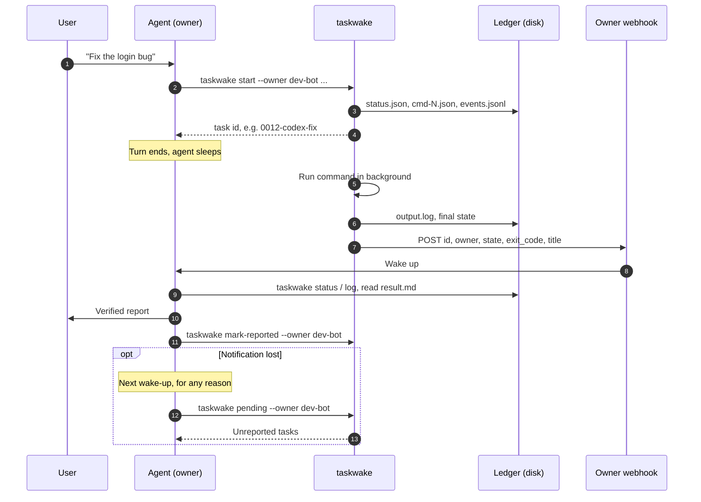
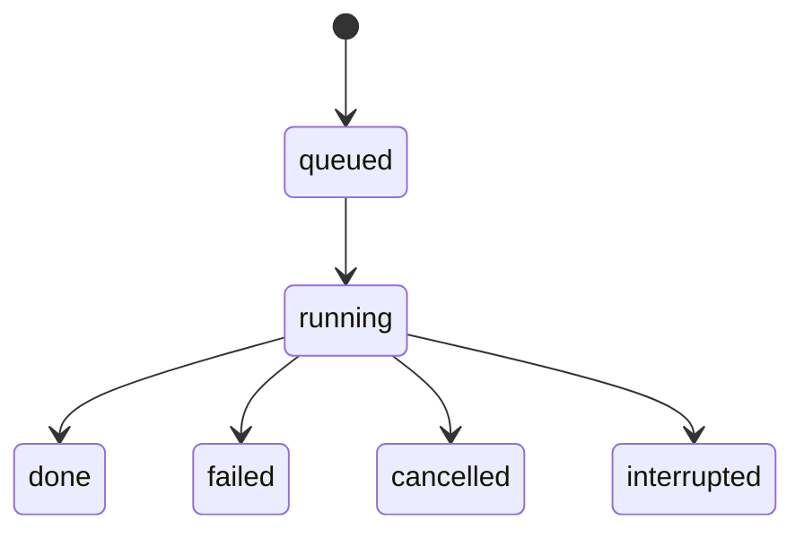

<div align="center">

# ⏰ taskwake

**面向 AI 智能体的后台任务账本；任务结束时，用 Webhook 唤醒派发该任务的智能体。**

[](https://github.com/sdpwh7-ux/taskwake/actions/workflows/ci.yml)
[](LICENSE)
[](https://www.python.org/)
[](#-功能特性)
[](#-功能特性)

[English](README.md) | **简体中文** | [日本語](README.ja.md)

</div>

> 把一个 40 分钟的 `codex exec` 放到后台，结束当前回合，任务完成时智能体会被唤醒。不用轮询，结果也不会被遗忘。

---

## 🤔 为什么需要它

聊天式智能体（按回合运行的机器人）处理长任务时有个难题：一旦把 40 分钟的 `codex exec` 或某个研究脚本放到后台，回合就结束了，智能体随之进入休眠。**任务完成时没人通知它**，它要么不停轮询（消耗额度），要么干脆忘了这件事。

taskwake 用三个简单的思路解决这个问题：

1. **账本（Ledger）。** 每个任务都有一个 `0012-codex-fix` 这样的 ID。状态、命令、stdout/stderr 和事件都会写入磁盘，以磁盘上的记录为准。
2. **唤醒（Wake-up）。** 任务结束后，taskwake 向*派发该任务的智能体自己的* Webhook POST 一段很小的 JSON。这个 Webhook 可以是任何能触发你的智能体的 HTTP 端点，比如调度器、机器人平台的 Webhook 触发器、CI 的 `repository_dispatch` 中转等。智能体被唤醒后核对结果、向用户汇报，然后把任务标记为已汇报。
3. **补报（Catch-up）。** 通知可能会丢。智能体无论因为什么被唤醒，都先运行 `taskwake pending --owner <me>`，把还没汇报的任务补报给用户。

## ✨ 功能特性

- 📒 **磁盘账本**：每个任务都有状态、命令、输出和事件日志，任务 ID 一看就懂。
- 🔔 **只唤醒派发者**：Webhook 只发给派发该任务的智能体。
- 🔁 **自带补报**：`pending` 列出已结束但尚未汇报的任务，通知丢了结果也不会丢。
- 🧩 **可包装任意命令**：Codex CLI、Claude Code（`claude -p`）、研究脚本、批处理作业、普通 shell 都行。
- ♻️ **可续跑**：可以用原命令重跑，也可以换新命令继续；Codex 的 `session id` 会记为 `codex_session`。
- ⏱️ **进程监管**：支持超时；按进程组取消（先 SIGTERM，10 秒后 SIGKILL）；运行进程消失时会被识别为 `interrupted`。
- 👥 **适合多智能体**：按归属者（owner）隔离，同一台机器上的多个智能体不会互相汇报或吞掉彼此的任务。
- 🔐 **谨慎处理凭据**：Webhook 密钥从不打印，配置文件权限为 600，Webhook 相关变量会从子进程环境中移除。
- 🪶 **零依赖**：单个文件，只用 Python 标准库（3.9+）。仅支持 POSIX（用到 `fcntl` 和进程组）。已在 Linux 上测试，macOS 应该也能用。

## ⚙️ 工作原理



任务生命周期：



`interrupted` 表示运行进程消失了，比如机器重启之后。taskwake 会在下一次执行命令时自动发现这种情况。

## 🚀 快速开始

### 安装

```bash
git clone https://github.com/sdpwh7-ux/taskwake.git
ln -s "$PWD/taskwake/taskwake" ~/.local/bin/taskwake    # or call taskwake.py directly
taskwake --help
```

### 派发与管理任务

```bash
# dispatch (backgrounds immediately and prints the task id)
taskwake start --owner research-bot --name demo --title "Smoke test" --sh 'sleep 5; echo hello'

taskwake list --owner research-bot         # running and recent tasks
taskwake status 0001-demo                  # details + recent events
taskwake log 0001-demo -n 50               # tail of output
taskwake cancel 0001-demo                  # SIGTERM the process group, SIGKILL after 10 s
taskwake resume 0001-demo                  # run again in the same task (same command)
taskwake resume 0001-demo --sh 'new cmd'   # continue with a new command
taskwake pending --owner research-bot      # finished but not yet reported
taskwake mark-reported 0001-demo --owner research-bot   # alias: ack
taskwake notify 0001-demo                  # resend the wake-up once
```

其他选项：`--cwd DIR`、`--timeout SEC`（默认不限时）、`--stdin FILE|-`、`--fg`（在前台运行，并返回命令的退出码）。

命令运行时可以使用以下变量：

| 变量 | 含义 |
| --- | --- |
| `$TASKWAKE_ID` | 任务 ID |
| `$TASKWAKE_DIR` | 任务目录（例如把结论写到 `$TASKWAKE_DIR/result.md`） |
| `$TASKWAKE_RUN` | 当前运行 |
| `$TASKWAKE_OWNER` | 任务归属者 |

退出码：

| 退出码 | 含义 |
| --- | --- |
| `0` | 完成 |
| `1` | 失败 / 被拒绝 |
| `2` | 用法错误 |
| `124` | 超时 |
| `130` | 已取消 |

### 示例

**Codex CLI**，把最终回答保存下来供核对。taskwake 会从输出中提取 Codex 的 `session id`，以 `codex_session` 字段记入 `status.json`，之后可以接着这个会话继续：

```bash
taskwake start --owner dev-bot --name codex-fix --cwd ~/src/myrepo --title "Fix login bug" \
  --sh 'codex exec --skip-git-repo-check -o "$TASKWAKE_DIR/result.md" "Fix the login bug, run the tests, list changed files"'

S=$(python3 -c 'import json,sys;print(json.load(open(sys.argv[1]))["codex_session"])' ~/.local/state/taskwake/tasks/0012-codex-fix/status.json)
taskwake resume 0012-codex-fix --sh "codex exec resume -o \"\$TASKWAKE_DIR/result.md\" $S 'One test still fails, keep going'"
```

**Claude Code**，通过 stdin 传入提示词：

```bash
taskwake start --owner dev-bot --name claude-refactor --stdin prompt.txt -- claude -p
```

### 归属者（Owner）

每个任务都会记录派发者（`--owner` 或 `$TASKWAKE_OWNER`），没有指定归属者的任务会被拒绝启动。唤醒通知只发给该归属者的 Webhook。`pending` 和 `list` 按归属者过滤；`mark-reported` 必须带 `--owner`，并且不接受其他归属者的任务。这样，共用一台机器的多个智能体就不会互相汇报或吞掉彼此的任务。

设置 `TASKWAKE_CHILD_OWNER_VAR=MY_AGENT_NAME` 后，归属者还会以这个变量名传给子进程，方便按智能体统计用量。

### 配置 Webhook

每个归属者只需保存一次 URL 和密钥。密钥从不回显或打印：

```bash
taskwake webhook-set --owner research-bot                                   # interactive, hidden input
taskwake webhook-set --owner research-bot --url https://... --key-file /path/to/keyfile
printf '%s' "$KEY" | taskwake webhook-set --owner research-bot --url https://... --key-stdin
taskwake webhook-check --owner research-bot   # "configured / not configured" + key length only
taskwake webhook-test  --owner research-bot   # sends {"source":"taskwake","event":"test"}
```

配置会写入 `~/.config/taskwake/<owner>.env`，权限为 600（参见 `examples/owner.env.example`）。如果环境变量里设置了 `TASKWAKE_WEBHOOK_URL` / `TASKWAKE_WEBHOOK_KEY`，以环境变量为准。

不配置 Webhook 也能用：任务照常记录，事件日志里写 `notify skipped`，智能体下次被唤醒时用 `pending` 补报。

### 发送的内容

```
POST <your webhook URL>
Content-Type: application/json
Authorization: Bearer <key>

{"source":"taskwake","id":"0012-codex-fix","owner":"dev-bot","state":"done","exit_code":0,"title":"Fix login bug"}
```

请求只包含任务元数据（ID、归属者、状态、退出码、标题），绝不包含命令行或命令输出。返回 2xx 即视为成功。失败时会在 0、5、20、60、180 秒后重试（`TASKWAKE_RETRY_DELAYS`）；400/401/403/404 视为配置错误，不重试。如果接收端还需要在另一个请求头里拿到密钥，设置 `TASKWAKE_WEBHOOK_KEY_HEADER=X-Your-Header`。`TASKWAKE_NOTIFY_OFF=1` 可关闭唤醒。

### 给智能体的说明

`examples/agent-skill.md` 是给派发方智能体的提示词，可以按需改写。它说明了怎样写下游提示词、怎样派发任务并结束回合、被唤醒后怎样核对和汇报，以及什么时候确认（ack）。

## 🔧 配置

| 变量 | 默认值 | 含义 |
| --- | --- | --- |
| `TASKWAKE_DIR` | `$XDG_STATE_HOME/taskwake/tasks` 或 `~/.local/state/taskwake/tasks` | 账本目录 |
| `TASKWAKE_CONF_DIR` | `~/.config/taskwake` | 各归属者的 Webhook 配置 |
| `TASKWAKE_OWNER` | - | 默认归属者 |
| `TASKWAKE_WEBHOOK_URL` / `TASKWAKE_WEBHOOK_KEY` | - | 覆盖各归属者的配置 |
| `TASKWAKE_WEBHOOK_KEY_HEADER` | - | 额外携带密钥的请求头 |
| `TASKWAKE_RETRY_DELAYS` | `0,5,20,60,180` | 每次通知尝试前等待的秒数 |
| `TASKWAKE_NOTIFY_OFF` | - | 设为 `1` 时关闭通知 |
| `TASKWAKE_CHILD_OWNER_VAR` | - | 同时以此变量名把归属者传给子进程 |

每个任务的账本目录包含：`status.json`、`events.jsonl`、`output.log`、`cmd-N.json`、`input-N.txt`（可选）、`result.md`（可选，由你的命令写入）。

## 🛡️ 安全模型

> 把 taskwake 交给智能体之前，请先读这一节。

- **Shell 权限。** taskwake 会以调用者的全部权限运行它收到的任何命令。它是账本和进程监管器，**不是沙箱**。沙箱要放在命令本身里（容器、`codex --sandbox`、受限用户）。
- **凭据。** Webhook 的 URL 和密钥只有 taskwake 会读取。`TASKWAKE_WEBHOOK_URL` 和 `TASKWAKE_WEBHOOK_KEY` 会从子进程环境中移除；`webhook-set`/`webhook-check` 从不打印密钥；配置文件以 600 权限创建在 700 权限的目录中。但环境里的其他密钥*会*传给子进程，需要的话请自行清理。
- **网络。** taskwake 只发一种外部请求：向配置好的 Webhook 发送的 POST，内容只有任务元数据（ID、归属者、状态、退出码、标题）。不要在标题里放密钥。
- **文件。** 账本里有完整的命令行、stdin 和输出。请确保 `TASKWAKE_DIR` 不对外可读（它的权限取决于你的 umask），也不要把密钥写在命令行里。
- **提示词注入。** Webhook 的请求体只能当作不可信的提示，智能体应重新读取账本。智能体回读 `output.log` 时，里面的命令输出同样不可信。
- **归属者隔离靠约定，不是真正的隔离。** 以同一 Unix 用户运行的任何进程都能读取和修改所有任务。需要真正隔离时，请使用不同的系统用户。

## 🗺️ 项目状态与路线图

taskwake **刚刚开源**。本文档列出的命令、选项和变量就是它目前的全部功能。可能还有不完善的地方，接口也可能根据反馈调整。

**已知限制**

- 重启会终止正在运行的任务（它们会显示为 `interrupted`）。如果运行进程本身被 `kill -9`，它的子进程可能还在继续运行。
- 同一任务同一时间只能有一次运行；有运行在进行时，`resume` 会拒绝执行。

**特别欢迎反馈的方向**

- 上述已知限制的改进思路。
- macOS 上的使用反馈（预期可用，但尚未测试）。
- 把唤醒 Webhook 接到不同智能体平台和调度器的做法。

没有固定的时间表，优先级由 issue 和实际使用情况决定。

## 🤝 参与贡献

欢迎提交 issue 和 pull request。

- 请保持现有设计：**单个文件、只用标准库、零依赖**。
- 请确认你的 PR 能通过 CI 工作流。
- 如果改变了行为，请同步更新 README（能的话，也一并更新译文）。
- 涉及安全的问题，请通过 GitHub 私下联系维护者，不要公开提 issue。

## 📄 许可与致谢

本项目改编自 Robbin Fan 的 [robbin/grokbot-local-agent](https://github.com/robbin/grokbot-local-agent) 中的任务账本设计（MIT）。上游许可证保留在 `LICENSE.upstream-MIT` 中。

本项目以 [MIT License](LICENSE) 发布。

---

### 🧰 智能体工具集（Part of the agent toolkit）

| 仓库 | |
| --- | --- |
| [**taskwake**](https://github.com/sdpwh7-ux/taskwake) | ← 当前仓库 |
| [agent-search-kit](https://github.com/sdpwh7-ux/agent-search-kit) | |
| [streamsafe](https://github.com/sdpwh7-ux/streamsafe) | |
| [agent-usage-ledger](https://github.com/sdpwh7-ux/agent-usage-ledger) | |
| [git-box-sync](https://github.com/sdpwh7-ux/git-box-sync) | |
